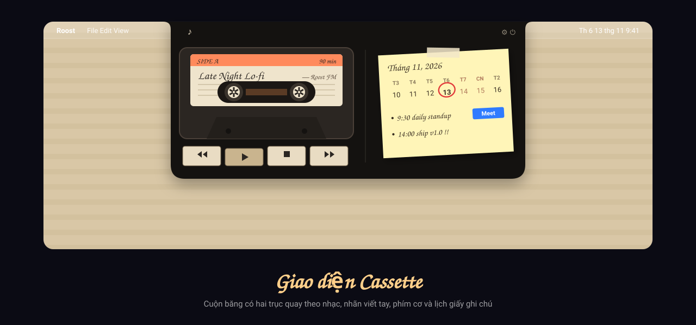
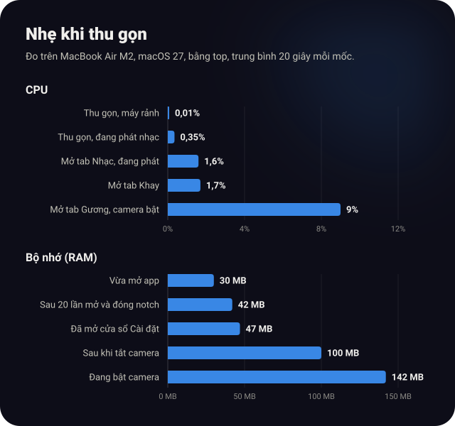

<p align="center">
  
</p>

<p align="center">
  
  
  
  
  
</p>

<p align="center">Rê chuột lên notch là thấy nhạc, lịch, khay file, gương camera và các yêu cầu của Claude Code ngay ở mép trên màn hình.<br>
Bạn không phải đổi Desktop hay mở thêm cửa sổ nào.</p>

<p align="center"></p>

<p align="center"></p>

<p align="center"></p>

<p align="center"></p>

<p align="center"></p>

<p align="center"></p>

<p align="center"></p>

<p align="center"></p>

<p align="center"></p>

## Giao diện

Có ba giao diện: Mặc định, Pixel 8-bit và Cassette. Đổi trong Cài đặt › Giao diện, notch đổi ngay mà không cần mở lại app.

### Pixel 8-bit

Chữ dùng font pixel VT323 (đủ dấu tiếng Việt). Notch bo góc kiểu bậc thang, nút bấm vuông có bóng lệch, thanh tiến trình chia thành từng đốt.

<p align="center"></p>
<p align="center"></p>

### Cassette

Trình phát nhạc là một cuộn băng có hai trục quay theo bài hát. Lịch viết trên giấy ghi chú, gương camera giống khung ngắm máy quay, còn yêu cầu xin quyền của Claude là một tờ phiếu đánh máy có đóng dấu.

<p align="center"></p>
<p align="center"></p>
<p align="center"></p>

App viết bằng SwiftUI và AppKit, build bằng Swift Package Manager. Bạn chỉ cần Command Line Tools, không cần Xcode.

## Tính năng

**Nhạc.** Roost hiện bài đang phát của mọi app: Spotify, Apple Music, YouTube trên trình duyệt, Podcasts. Có ảnh bìa, thanh tiến trình và các nút phát, dừng, chuyển bài. Kéo thanh tiến trình để tua (ở giao diện Cassette thì kéo ngang thân băng). Bấm ảnh bìa để mở app đang phát. Khi notch thu gọn, hai cánh hiện ảnh bìa và cột sóng nhạc, viền notch có quầng sáng theo màu ảnh bìa. Cột sóng có thể chạy theo âm thanh thật nếu bạn bật trong Cài đặt; tuỳ chọn này mặc định tắt vì khi bật, macOS hiện chấm tím trên thanh menu.

**Lịch.** Dải 7 ngày, chuyển tuần bằng nút ‹ › hoặc vuốt trackpad. Bấm một ngày để xem sự kiện, có nút vào thẳng Google Meet, Zoom hay Teams.

**Khay file.** Kéo file lên notch để cất tạm, rồi kéo ra thả vào app khác. File bạn thả vào sẽ bay theo một đường cong vào đúng ô của nó trong khay. Ảnh và video có ảnh xem trước; ở giao diện Cassette chúng hiện thành tấm Polaroid. Bấm để chọn file, ⌘-bấm để chọn thêm, rồi kéo cả nhóm ra ngoài một lần. Phím cách mở Quick Look như trong Finder. Khi khay có nhiều loại file, một bộ lọc nhỏ hiện ra để lọc ảnh, tài liệu hay loại khác.

Ảnh chụp màn hình tự vào khay, kể cả khi bạn chụp vào clipboard. App chỉ nhận ảnh khi công cụ chụp màn hình của macOS vừa chạy, nên ảnh bạn copy từ Preview không bị nhận nhầm. Khay giữ liên kết tới file gốc: đổi tên hay chuyển chỗ thì file vẫn còn, bỏ vào Thùng rác thì file tự rời khay. Chuột phải để AirDrop, chia sẻ hoặc hiện trong Finder. Bạn có thể cho khay tự dọn sau 1, 7 hoặc 30 ngày.

**Thú cưng.** Mỗi giao diện có một con riêng ngồi ở cánh notch: cáo ở giao diện Mặc định, khủng long ở Pixel, máy Walkman vẽ tay ở Cassette. Nó nhảy khi có nhạc, mắt nhìn theo con trỏ, đeo tai nghe khi bạn nối AirPods, giật mình khi bạn chụp màn hình hay khi Claude xin quyền, và thỉnh thoảng tự làm trò. Hoạt ảnh chạy bằng Core Animation nên gần như không tốn CPU.

**Gương camera.** Soi webcam ngay trên notch trước khi họp, chọn lật kiểu gương hoặc xem như người khác thấy, kèm cuộc họp sắp tới và nút vào Meet. App nhắc khi mặt bạn lệch khung, ngồi quá gần hoặc quá xa, và báo khi mặt thiếu sáng (kèm nút bật đèn viền). Việc nhận diện dùng Vision, tối đa 2 khung hình mỗi giây. Camera chỉ chạy khi tab đang mở và không ghi hay lưu hình nào.

**Đèn viền.** Một viền trắng ấm quanh mép màn hình để rọi sáng mặt khi gọi video trong phòng tối. Có ba mức: Dịu, Vừa, Mạnh.

**Báo nhanh trên cánh notch** khi cắm sạc (kèm % pin), khi kết nối tai nghe hay loa Bluetooth, và khi có ảnh chụp vừa vào khay.

**Claude Code.** Duyệt quyền và trả lời câu hỏi của Claude ngay trên notch. Mỗi thẻ ghi rõ project, phiên và app đang chạy Claude (VS Code, Terminal, iTerm), kèm đồng hồ đếm ngược tới lúc Claude thôi chờ. Lệnh chạy, sửa file, câu hỏi và duyệt kế hoạch có nhãn khác nhau để bạn nhận ra ngay. Khi nhiều phiên cùng hỏi, hàng tab hiện hàng đợi kiểu "1/3"; mỗi thẻ có kết nối riêng nên trả lời thẻ này không bao giờ ảnh hưởng thẻ khác. Bấm xong, thẻ hiện kết quả (đã cho phép, đã từ chối, hết giờ) khoảng một giây rồi mới rời đi. Một nút trên thẻ đưa bạn về đúng cửa sổ terminal hay VS Code của phiên đó.

**Nhiều màn hình.** Notch có thể hiện trên màn hình có notch, màn hình chính, màn hình đang có con trỏ, hoặc tất cả màn hình cùng lúc và đồng bộ với nhau. Màn hình rời được vẽ thêm một notch, hoặc bạn chọn kiểu viên nổi giống Dynamic Island, cách mép trên vài điểm ảnh.

**Tự điều chỉnh.** Khi bạn xem video, chơi game hay trình chiếu toàn màn hình, notch thu về dạng tối giản. Khi bật Low Power Mode hoặc pin dưới 20%, app tắt sóng nhạc thật, thú cưng và quầng sáng.

**Tuỳ chỉnh.** Chọn giao diện, kích thước khi mở (Gọn, Vừa, Rộng), rung nhẹ trên trackpad Force Touch, ngôn ngữ (Tiếng Việt hoặc English), và bật tắt từng tab. Notch mở khi bạn bấm vào, hoặc khi rê chuột lên. Ở chế độ rê chuột mặc định ("Thông minh"), notch chỉ mở khi con trỏ chậm lại hay dừng ở đó; lướt nhanh qua để bấm icon trên thanh menu thì không mở. Bạn cũng có thể chọn độ trễ cố định. Phím tắt mặc định là ⌥ Space và không cần quyền Trợ năng. Lần đầu mở app có màn hình chào hướng dẫn cấp quyền và cài hook cho Claude Code.

## Hiệu năng

<p align="center"></p>

Lúc notch thu gọn, Roost gần như không dùng CPU: app chỉ thức dậy khi có sự kiện chuột, nhạc hay hệ thống, không chạy vòng lặp nền. Phần tốn nhất là tab Gương khi camera bật. Tab Nhạc lúc đang phát chỉ còn 1,6%, vì thanh tiến độ do Core Animation tự chạy và đồng hồ chỉ cập nhật mỗi giây. Thú cưng, sóng nhạc và hiệu ứng chạy bằng Core Animation trong render server của macOS, nên không tính vào CPU của app.

| Trạng thái | CPU | RAM |
|---|---|---|
| Thu gọn, máy rảnh | 0,01% | 30 MB lúc vừa mở app |
| Thu gọn, đang phát nhạc | 0,35% | |
| Mở tab Nhạc, đang phát | 1,6% | |
| Mở tab Khay | 1,7% | |
| Mở tab Gương, camera bật | 9% | 142 MB |
| Sau 20 lần mở và đóng notch | | 42 MB |
| Sau khi tắt camera | | khoảng 100 MB |

Số liệu đo ngày 14/11/2026 trên MacBook Air M2, macOS 27, bằng `top`, trung bình 20 giây mỗi mốc. `leaks` báo 0 chỗ rò bộ nhớ. Sau lần đầu mở tab Gương, RAM không về lại mức cũ, vì macOS giữ model nhận diện khuôn mặt của Vision và bộ xử lý camera trong app cho tới khi app tắt. Chi tiết cách đo và các hạng mục còn lại trước khi phát hành nằm ở [docs/RELEASE-CHECKLIST.md](docs/RELEASE-CHECKLIST.md).

## Build và cài đặt

```bash
scripts/make-signing-cert.sh   # 1 lần: chứng chỉ ký code tự ký trong login keychain
./build.sh install             # build, ký, cài vào /Applications/Roost.app rồi mở
```

App được ký bằng một chứng chỉ cố định để macOS nhớ các quyền đã cấp (điều khiển Spotify, đọc Lịch, camera) qua những lần build sau. Nếu không có chứng chỉ, `build.sh` ký ad-hoc và macOS sẽ hỏi lại quyền sau mỗi lần build.

Lệnh khác: `./build.sh run` chạy bản trong `build/`; `scripts/set-icon.sh <ảnh>` đổi icon; `scripts/set-icon.sh --default` trả lại icon mặc định.

Roost trước đây tên Notch (`/Applications/Notch.app`, bundle id `local.toan.notch`). Lần đầu chạy, Roost tự chép các cài đặt cũ (giao diện, khay, mở khoá bằng khuôn mặt, nhật ký) và chuyển thư mục `~/Library/Application Support/Notch/` thành `Roost/`. `./build.sh install` gỡ luôn `Notch.app` cũ. Vì bundle id đã đổi, macOS sẽ hỏi lại các quyền: Lịch, Camera, Trợ năng, điều khiển Spotify/Music và ghi âm thanh hệ thống.

## Nối với Claude Code

Màn hình chào có sẵn nút sao chép cấu hình (mở lại ở Cài đặt › Giới thiệu › Mở hướng dẫn cài đặt). Thêm đoạn sau vào `~/.claude/settings.json`, hoặc `.claude/settings.json` của từng project:

```json
{
  "hooks": {
    "PermissionRequest": [{
      "matcher": "*",
      "hooks": [{ "type": "command", "command": "/Applications/Roost.app/Contents/MacOS/roost-hook", "timeout": 110 }]
    }],
    "PostToolUse": [{
      "matcher": "*",
      "hooks": [{ "type": "command", "command": "/Applications/Roost.app/Contents/MacOS/roost-hook", "timeout": 5 }]
    }],
    "PostToolUseFailure": [{
      "matcher": "*",
      "hooks": [{ "type": "command", "command": "/Applications/Roost.app/Contents/MacOS/roost-hook", "timeout": 5 }]
    }],
    "Stop": [{
      "hooks": [{ "type": "command", "command": "/Applications/Roost.app/Contents/MacOS/roost-hook", "timeout": 5 }]
    }],
    "SessionEnd": [{
      "hooks": [{ "type": "command", "command": "/Applications/Roost.app/Contents/MacOS/roost-hook", "timeout": 5 }]
    }]
  }
}
```

`roost-hook` gửi yêu cầu sang app qua Unix socket `~/Library/Application Support/Roost/claude.sock` (quyền 0600). Nếu app đang tắt, hết thời gian chờ, hoặc bạn bấm "Trả lời trong VS Code", hook trả về mà không quyết định gì và Claude Code hỏi bạn như bình thường.

Hộp thoại xin quyền trong terminal chạy song song với hook. Nếu bạn trả lời trong terminal, hook vẫn chờ tới hết giờ. Bốn event `PostToolUse`, `PostToolUseFailure`, `Stop` và `SessionEnd` dùng chung binary, tự nhận loại event qua `hook_event_name`, chạy trong vài mili giây và không in gì ra; chúng báo cho app gỡ thẻ tương ứng của session đó. Nếu chỉ cài `PermissionRequest` thì app vẫn chạy, chỉ có điều thẻ bạn đã trả lời trong terminal sẽ nằm lại tới khi hook hết giờ. Khi bạn ngắt Claude (Esc) hoặc đóng session, hook bị dừng, socket đóng và thẻ tự biến mất. Nếu Roost bị tắt hay crash giữa chừng, hook thoát ngay mà không quyết định gì, nên Claude Code không bao giờ bị treo.

"Luôn cho phép" chỉ áp đúng một quy tắc hẹp nhất mà Claude gợi ý, ví dụ `Bash(npm test:*)`. Thẻ ghi rõ quy tắc đó và nơi lưu trước khi bạn bấm: chỉ trong phiên này, hay lưu vào `.claude/settings.local.json` của project. Roost không bao giờ bật chế độ bỏ qua quyền. Cài đặt › Claude Code liệt kê các quy tắc Roost đã cấp, kèm nút Thu hồi; app sao lưu file rồi chỉ gỡ đúng dòng quy tắc đó.

## Mở khoá bằng khuôn mặt (thử nghiệm)

<p align="center"></p>

Tính năng này nằm ở Cài đặt › Khuôn mặt và mặc định tắt. Nó có hai phần.

Phần thứ nhất là hiệu ứng Face ID khi mở khoá. Phần này bật sẵn và không dùng camera: màn hình khoá có biểu tượng Face ID cạnh notch, và khi bạn mở khoá bằng bất kỳ cách nào (Touch ID, Apple Watch, mật khẩu), notch chạy hiệu ứng quét, hiện dấu ✓, chào bạn theo tên và thú cưng nhảy mừng.

Phần thứ hai là mở khoá thật, bạn tự bật sau khi thiết lập. Khi máy khoá hoặc thức dậy, hoặc khi bạn rê chuột lên notch trên màn hình khoá, app quét mặt qua camera. Nếu đúng người, app gõ mật khẩu đăng nhập đã lưu vào màn hình khoá.

> [!WARNING]
> Đây là tiện ích, không phải lớp bảo mật. Camera MacBook chỉ thấy ảnh 2D. Bước kiểm tra người thật (mặc định ở mức Nặng) chặn được ảnh in và ảnh trên điện thoại, nhưng một video quay mặt bạn vẫn có thể qua được. Tính năng chỉ dùng được khi bạn đã đăng nhập, không thay được việc nhập mật khẩu sau khi khởi động lại máy. App cần quyền Trợ năng để gõ mật khẩu.

Mật khẩu và dữ liệu khuôn mặt được mã hoá AES-256 bằng một khoá lưu trong login keychain. App chỉ lấy khoá ra sau khi bạn xác thực bằng Touch ID hoặc mật khẩu. Vì bản tự ký không dùng được keychain `userPresence`, bước kiểm tra Touch ID này nằm trong code của app. Phiên Touch ID tự khoá sau 8 giờ không dùng; bạn đổi được thời gian này.

Các giới hạn an toàn:

- Sai 5 lần liên tiếp trong một lần khoá máy thì app ngừng quét, cho tới khi bạn mở khoá bằng cách khác.
- App chỉ dùng camera thật, tức camera tích hợp hoặc camera USB. App không nhận Continuity Camera và camera ảo (tên, model hoặc hãng có chứa OBS, Snap Camera, Camo, mmhmm, Ecamm, ManyCam, XSplit, NVIDIA Broadcast, DroidCam, iVCam, EpocCam hay chữ "virtual").
- Nhật ký 50 lần thử gần nhất xem và xoá được trong Cài đặt.
- Không có distributed notification hay kênh IPC nào của Roost kích hoạt được việc quét mặt hoặc gõ phím.

Các bước thiết lập: cấp quyền camera, cấp quyền Trợ năng, mở phiên Touch ID, lưu mật khẩu đăng nhập, quét mặt theo 9 hướng, rồi bật "Mở khoá bằng khuôn mặt". Để thử, khoá máy bằng ⌃⌘Q rồi nhìn vào camera hoặc rê chuột lên notch.

Ghi công: phần nhận diện được chuyển từ [Glance](https://github.com/jonnyoo/glance) (MIT, © Jonathan Zhou). Cách đưa cửa sổ lên màn hình khoá dựa trên [SkyLightWindow](https://github.com/Lakr233/SkyLightWindow) (MIT, © Lakr Aream). Model nhận diện là ArcFace `w600k_mbf` của [InsightFace](https://github.com/deepinsight/insightface), chỉ được phép dùng cho nghiên cứu phi thương mại; Roost là app cá nhân, không thương mại. Chi tiết xem `Packages/FaceUnlockKit/NOTICE.md` và thư mục `LICENSES/` (cũng được chép vào `Contents/Resources/FaceUnlockKit/` trong app).

## Ghi chú kỹ thuật

- Font pixel [VT323](https://fonts.google.com/specimen/VT323) được đóng gói kèm app theo giấy phép SIL Open Font License 1.1 (`Resources/OFL-VT323.txt`).
- SDK macOS 27 biến `@State` và `@Namespace` của SwiftUI thành macro, mà plugin cho macro chỉ có trong Xcode. Vì vậy code dùng `State(initialValue:)` và `Namespace()` tường minh.
- Thông tin bài hát lấy qua [mediaremote-adapter](https://github.com/ungive/mediaremote-adapter) v0.7.7 (BSD 3-Clause). Mã nguồn nằm ở `Vendor/MediaRemoteAdapter`, giấy phép ở `Vendor/MediaRemoteAdapter/LICENSE` và `Contents/Resources/LICENSE-mediaremote-adapter.txt`. Adapter chạy qua `/usr/bin/perl`, chương trình được phép dùng MediaRemote, nên đọc được mọi nguồn phát kể cả trên macOS 15.4 trở lên. `build.sh` tự build framework bằng clang, không cần CMake. Nếu adapter lỗi hoặc không có gì đang phát, app quay về đọc Spotify và Music bằng AppleScript.
- Con trỏ chuột được theo dõi bằng `NSEvent` monitor, không poll và không cần quyền Trợ năng. Timer 30 lần mỗi giây chỉ chạy khi notch đang mở, nên lúc thu gọn app gần như không tốn CPU.
- Sóng nhạc giả lập và thú cưng chạy bằng Core Animation trong render server. Sóng nhạc thật dùng Core Audio process tap (macOS 14.2 trở lên) và FFT của Accelerate, chỉ chạy khi đang phát nhạc.
- App nhận biết chế độ toàn màn hình qua khung cửa sổ (`CGWindowList`), không cần quyền Screen Recording. Ảnh chụp màn hình được nhận qua Spotlight (`kMDItemIsScreenCapture`) và qua clipboard, nhưng chỉ khi `screencaptureui` đang chạy hoặc vừa mở hay tắt trong vòng 4 giây.
