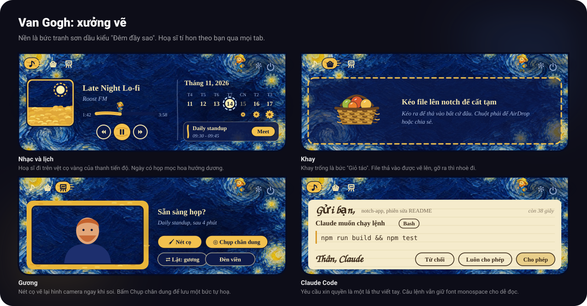
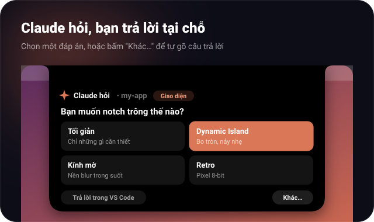
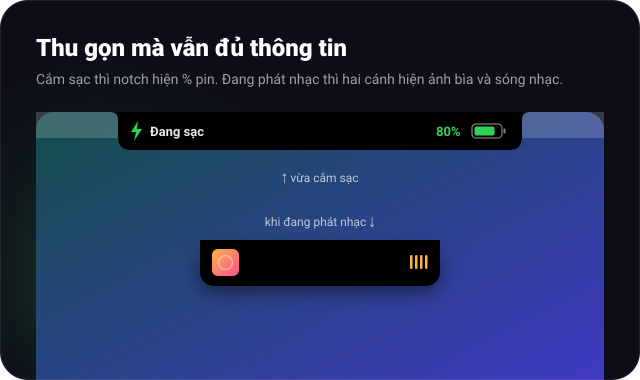
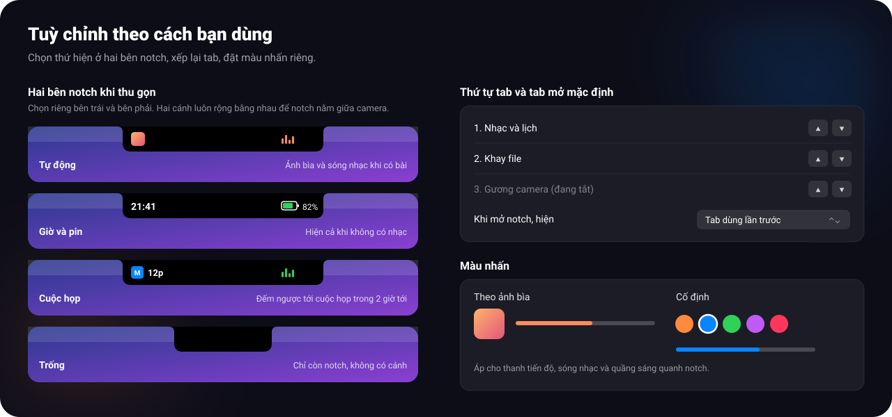
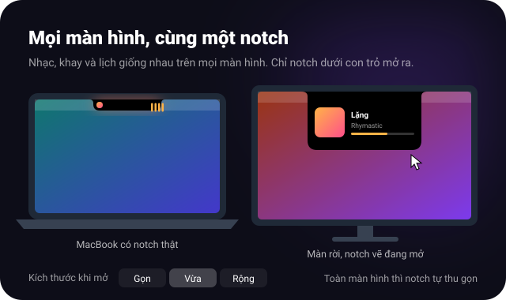

<p align="center">
  
</p>

<p align="center">
  <a href="https://github.com/letoan1/notch-app/releases"></a>
  
  
  
  
  
</p>

<p align="center">
Roost biến phần tai thỏ (notch) của MacBook thành một bảng nhỏ ở mép trên màn hình.<br>
Rê chuột lên là thấy nhạc, lịch, khay file, gương camera và các yêu cầu của Claude Code.
</p>

<p align="center"><sub>English: Roost is a free, open-source notch app for macOS 14+ with music, calendar, a file shelf, a camera mirror, Claude Code approvals and four themed skins. The UI is in Vietnamese and English.</sub></p>

## Mục lục

- [Tải về](#tải-về)
- [Giao diện](#giao-diện)
- [Tính năng](#tính-năng)
- [Nối với Claude Code](#nối-với-claude-code)
- [Quyền và quyền riêng tư](#quyền-và-quyền-riêng-tư)
- [Hiệu năng](#hiệu-năng)
- [Tự build](#tự-build)
- [Câu hỏi thường gặp](#câu-hỏi-thường-gặp)
- [Lộ trình](#lộ-trình)
- [Ghi công và giấy phép](#ghi-công-và-giấy-phép)

## Tải về

1. Tải file `Roost-<phiên bản>.dmg` ở trang [Releases](https://github.com/letoan1/notch-app/releases). File chạy được trên Mac chip Apple và Mac Intel, cần macOS 14 trở lên.
2. Mở file, kéo Roost vào thư mục Applications.
3. Lần đầu mở, macOS sẽ báo không xác minh được nhà phát triển. Roost chưa được ký bằng chứng chỉ Developer ID của Apple nên cảnh báo này là bình thường. Vào System Settings › Privacy & Security, bấm **Open Anyway**. Việc này chỉ làm một lần.

Hướng dẫn chi tiết từng bước, kèm cách kiểm tra mã SHA-256 của file tải về, nằm ở [docs/INSTALL.md](docs/INSTALL.md). Máy không có tai thỏ vẫn dùng được: Roost vẽ một notch giả ở giữa mép trên màn hình.

## Giao diện

<p align="center"></p>

Roost có bốn giao diện. Đổi trong Cài đặt › Giao diện, notch đổi ngay mà không cần mở lại app. Ba giao diện Pixel, Cassette và Van Gogh không chỉ đổi màu: mỗi tab có cách hoạt động riêng theo câu chuyện của giao diện đó, kèm hiệu ứng riêng khi chuyển tab.

### Pixel 8-bit

<p align="center"></p>

Một chiếc máy game thùng. Thanh tiến độ là thanh EXP; nghe xong một bài là lên cấp và hiện chữ LEVEL UP. Lịch là màn chọn level, ngày có họp có quái vật pixel nhỏ, ngày hôm nay có lá cờ nhấp nháy. Khay là các ô đồ đạc: thả file vào hiện "+1 ITEM", gỡ ra thì file vỡ thành pixel. Khay trống là một rương kho báu, kéo file tới thì rương mở nắp. Tab Gương có chế độ Selfie 8-bit và nút chụp avatar. Yêu cầu của Claude hiện như hộp thoại game nhập vai, chọn bằng con trỏ ▶. Chữ dùng font VT323, có đủ dấu tiếng Việt. Mọi hình pixel là thiết kế riêng của Roost.

### Cassette

<p align="center"></p>

Một góc bàn thập niên 80. Trình phát nhạc là cuộn băng có hai trục quay theo bài; kéo ngang thân băng để tua, lúc đó trục quay nhanh và màn hình hiện vạch nhiễu. Lịch là lịch bloc, đổi ngày thì tờ cũ bị xé đi; trang lịch liệt kê đủ việc trong ngày. Trong khay, ảnh là tấm Polaroid, nhạc là băng cassette, các file khác là đĩa mềm dán nhãn viết tay. Tab Gương là máy ảnh chụp lấy liền: bấm Chụp, tấm ảnh trồi ra rồi hiện dần, còn file lưu vào khay và `~/Pictures/Roost` là ảnh gốc của camera. Yêu cầu của Claude in ra trên tờ telex, bấm nút nào thì con dấu đó được đóng lên giấy.

### Van Gogh

<p align="center"></p>

Một xưởng vẽ. Nền notch là bức tranh sơn dầu kiểu "Đêm đầy sao", thú cưng là hoạ sĩ tí hon đội mũ rơm. Thanh tiến độ là một vệt cọ vàng, hoạ sĩ đi ở đầu vệt. Ảnh bìa bài hát được vẽ lại thành tranh sơn dầu. Ngày có họp mọc hoa hướng dương, càng nhiều họp hoa càng to. Khay trống là bức "Giỏ táo"; file thả vào hiện dần như đang được vẽ lên, gỡ ra thì nhoè đi. Tab Gương có nút Nét cọ để vẽ lại hình camera theo thời gian thực, và nút Chụp chân dung để lưu một bức tự hoạ. Yêu cầu của Claude là một lá thư viết tay, riêng câu lệnh vẫn dùng font monospace cho dễ đọc. Đổi tab thì vài vệt cọ quét qua.

Livestream (YouTube, Twitch) không có độ dài, nên ở mọi giao diện thanh tiến độ được thay bằng nhãn "Trực tiếp".

## Tính năng

### Duyệt yêu cầu của Claude Code

<p align="center"></p>
<p align="center"></p>

Khi Claude Code xin chạy lệnh, sửa file hay hỏi bạn một câu, notch tự mở và hiện thẻ. Mỗi thẻ ghi project, phiên và app đang chạy Claude (VS Code, Terminal, iTerm), kèm đồng hồ đếm ngược tới lúc Claude thôi chờ. Nhiều phiên cùng hỏi thì hàng tab hiện hàng đợi kiểu "1/3"; trả lời thẻ này không ảnh hưởng thẻ khác. Một nút trên thẻ đưa bạn về đúng cửa sổ terminal hay VS Code của phiên đó. Cách cài nằm ở mục [Nối với Claude Code](#nối-với-claude-code).

### Nhạc và lịch

<p align="center"></p>

Roost hiện bài đang phát của mọi app: Spotify, Apple Music, YouTube trên trình duyệt, Podcasts. Có ảnh bìa, thanh tiến độ để kéo tua và các nút điều khiển; bấm ảnh bìa để mở app đang phát. Khi notch thu gọn, hai cánh hiện ảnh bìa và sóng nhạc, viền notch có quầng sáng theo màu ảnh bìa. Sóng nhạc có thể chạy theo âm thanh thật nếu bạn bật trong Cài đặt.

Lịch là dải 7 ngày, chuyển tuần bằng nút hoặc vuốt trackpad. Bấm một ngày để xem sự kiện, có nút vào thẳng Google Meet, Zoom hay Teams.

### Khay file

<p align="center"></p>
<p align="center"></p>

Kéo file lên notch để cất tạm, rồi kéo ra thả vào app khác. Bấm để chọn, ⌘-bấm để chọn thêm, kéo cả nhóm ra một lần. Phím cách mở Quick Look như trong Finder. Ảnh chụp màn hình tự vào khay, kể cả khi bạn chụp vào clipboard. Khay giữ liên kết tới file gốc nên đổi tên hay chuyển chỗ vẫn không mất; bỏ file vào Thùng rác thì nó tự rời khay. Chuột phải để AirDrop, chia sẻ hoặc hiện trong Finder. Khay có thể tự dọn sau 1, 7 hoặc 30 ngày.

### Gương camera

<p align="center"></p>

Soi webcam ngay trên notch trước khi họp, kèm cuộc họp sắp tới và nút vào Meet. App nhắc khi mặt bạn lệch khung, ngồi quá gần hay quá xa, và khi mặt thiếu sáng thì gợi ý bật đèn viền: một viền trắng ấm quanh mép màn hình với ba mức Dịu, Vừa, Mạnh. Camera chỉ chạy khi tab đang mở.

### Thú cưng

<p align="center"></p>

Mỗi giao diện có một con ngồi ở cánh notch: cáo, khủng long pixel, máy Walkman và hoạ sĩ tí hon. Nó nhảy theo nhạc, nhìn theo con trỏ, đeo tai nghe khi âm thanh đang ra tai nghe (AirPods hay tai nghe Bluetooth, USB khác), giật mình khi bạn chụp màn hình hay khi Claude xin quyền. Hoạt ảnh chạy bằng Core Animation nên gần như không tốn CPU. Bật tắt trong Cài đặt › Chung.

### Tuỳ chỉnh

<p align="center"></p>
<p align="center"></p>

- **Hai bên notch khi thu gọn**: chọn riêng bên trái và bên phải giữa ảnh bìa, sóng nhạc, cuộc họp kế tiếp, pin, giờ hoặc để trống.
- **Thứ tự tab và tab mở mặc định**: xếp lại tab, chọn tab hiện ra khi mở notch hoặc giữ tab dùng lần trước.
- **Màu nhấn**: theo ảnh bìa, hoặc cố định một màu cho thanh tiến độ, sóng nhạc và quầng sáng.
- **Cách mở notch**: bấm, hoặc rê chuột. Ở chế độ rê chuột mặc định ("Thông minh"), notch chỉ mở khi con trỏ chậm lại; lướt nhanh qua để bấm icon trên thanh menu thì không mở.
- Kích thước khi mở (Gọn, Vừa, Rộng), phím tắt (mặc định ⌥ Space, không cần quyền Trợ năng), rung nhẹ trên trackpad Force Touch, Tiếng Việt hoặc English, bật tắt từng tab.

### Nhiều màn hình và tiết kiệm pin

<p align="center"></p>

Notch có thể hiện trên màn hình có tai thỏ, màn hình chính, màn hình đang có con trỏ, hoặc mọi màn hình cùng lúc. Màn hình rời được vẽ thêm một notch, hoặc bạn chọn kiểu viên nổi tách khỏi mép trên. Khi bạn xem video hay trình chiếu toàn màn hình, notch thu về dạng tối giản. Khi bật Low Power Mode hoặc pin dưới 20%, Roost tắt sóng nhạc thật, thú cưng và quầng sáng.

### Mở khoá bằng khuôn mặt (thử nghiệm)

<p align="center"></p>

Tính năng này nằm ở Cài đặt › Khuôn mặt và mặc định tắt. Khi bật, lúc máy khoá hay thức dậy, Roost quét mặt qua camera; đúng người thì app gõ mật khẩu đăng nhập đã lưu vào màn hình khoá. Không bật phần này thì notch vẫn chạy hiệu ứng Face ID mỗi khi bạn mở khoá bằng Touch ID, Apple Watch hay mật khẩu, và không dùng camera.

> [!WARNING]
> Đây là tiện ích, không phải lớp bảo mật. Camera MacBook chỉ thấy ảnh 2D. Bước kiểm tra người thật chặn được ảnh in và ảnh trên điện thoại, nhưng một video quay mặt bạn vẫn có thể qua. Tính năng không thay được việc nhập mật khẩu sau khi khởi động lại máy.

Mật khẩu và dữ liệu khuôn mặt được mã hoá AES-256, khoá lưu trong login keychain và chỉ được lấy ra sau khi bạn xác thực bằng Touch ID hoặc mật khẩu. Sai 5 lần liên tiếp thì app ngừng quét tới khi bạn mở khoá bằng cách khác. App chỉ nhận camera thật, không nhận Continuity Camera hay camera ảo. Nhật ký 50 lần thử gần nhất xem và xoá được trong Cài đặt.

## Nối với Claude Code

Màn hình chào lần đầu có nút sao chép cấu hình (mở lại ở Cài đặt › Giới thiệu). Hoặc thêm đoạn sau vào `~/.claude/settings.json`, hay `.claude/settings.json` của từng project:

```json
{
  "hooks": {
    "PermissionRequest": [{
      "matcher": "*",
      "hooks": [{ "type": "command", "command": "/Applications/Roost.app/Contents/MacOS/roost-hook", "timeout": 110 }]
    }],
    "PostToolUse": [{
      "matcher": "*",
      "hooks": [{ "type": "command", "command": "/Applications/Roost.app/Contents/MacOS/roost-hook", "timeout": 5 }]
    }],
    "PostToolUseFailure": [{
      "matcher": "*",
      "hooks": [{ "type": "command", "command": "/Applications/Roost.app/Contents/MacOS/roost-hook", "timeout": 5 }]
    }],
    "Stop": [{
      "hooks": [{ "type": "command", "command": "/Applications/Roost.app/Contents/MacOS/roost-hook", "timeout": 5 }]
    }],
    "SessionEnd": [{
      "hooks": [{ "type": "command", "command": "/Applications/Roost.app/Contents/MacOS/roost-hook", "timeout": 5 }]
    }]
  }
}
```

Muốn xem thử thẻ trên notch mà không cần mở Claude, chạy `scripts/demo-claude.sh` (thêm `--question` cho thẻ câu hỏi). Script chỉ in ra lựa chọn của bạn, không ghi gì vào cài đặt Claude.

Cách hook hoạt động:

- `roost-hook` gửi yêu cầu sang app qua Unix socket `~/Library/Application Support/Roost/claude.sock` (quyền 0600). Nếu app đang tắt, hết thời gian chờ, hoặc Roost bị tắt giữa chừng, hook trả về mà không quyết định gì và Claude Code hỏi bạn như bình thường. Claude Code không bao giờ bị treo vì Roost.
- Hộp thoại trong terminal chạy song song với hook. Bốn event `PostToolUse`, `PostToolUseFailure`, `Stop` và `SessionEnd` dùng chung binary, chạy trong vài mili giây và báo cho app gỡ thẻ bạn đã trả lời ở terminal. Thiếu chúng thì app vẫn chạy, chỉ là thẻ đó nằm lại tới khi hook hết giờ.
- "Luôn cho phép" chỉ áp đúng quy tắc hẹp nhất mà Claude gợi ý, ví dụ `Bash(npm test:*)`. Thẻ ghi rõ quy tắc và nơi lưu trước khi bạn bấm: chỉ trong phiên này, hay trong `.claude/settings.local.json` của project. Roost không bao giờ bật chế độ bỏ qua quyền.
- Cài đặt › Claude Code liệt kê các quy tắc Roost đã cấp, kèm nút Thu hồi. App sao lưu file rồi chỉ gỡ đúng dòng quy tắc đó.

## Quyền và quyền riêng tư

Roost không gửi dữ liệu nào ra Internet, không có analytics hay theo dõi. Mỗi quyền chỉ được xin khi bạn dùng tới tính năng cần nó.

| Quyền | Dùng cho | Bắt buộc? |
|---|---|---|
| Lịch | Hiện sự kiện, nút vào cuộc họp, đếm ngược ở cánh notch | Không, chỉ khi dùng lịch |
| Camera | Tab Gương, mở khoá bằng khuôn mặt. Hình chỉ được lưu khi bạn bấm nút chụp | Không |
| Tự động hoá (Apple Events) | Đọc bài và điều khiển Spotify, Music khi cách đọc chính không dùng được | Không |
| Ghi âm thanh hệ thống (Screen & System Audio Recording) | Sóng nhạc theo âm thanh thật. Mặc định tắt; khi bật, macOS hiện chấm tím trên thanh menu. Roost không ghi hay lưu âm thanh | Không |
| Trợ năng (Accessibility) | Gõ mật khẩu vào màn hình khoá khi mở khoá bằng khuôn mặt | Chỉ cho tính năng đó |
| Keychain | Giữ khoá mã hoá của mở khoá bằng khuôn mặt | Chỉ cho tính năng đó |

Roost nhận biết chế độ toàn màn hình qua khung cửa sổ, không cần quyền ghi màn hình. Ảnh chụp màn hình được nhận qua Spotlight và clipboard, chỉ khi công cụ chụp của macOS vừa chạy.

## Hiệu năng

<p align="center"></p>

Lúc notch thu gọn, Roost gần như không dùng CPU: app chỉ thức dậy khi có sự kiện chuột, nhạc hay hệ thống, không chạy vòng lặp nền. Thanh tiến độ, sóng nhạc, thú cưng và các hiệu ứng chạy bằng Core Animation trong render server của macOS. Phần tốn nhất là tab Gương khi camera bật.

| Trạng thái (giao diện Mặc định) | CPU | RAM |
|---|---|---|
| Thu gọn, máy rảnh | 0,01% | 30 MB lúc vừa mở app |
| Thu gọn, đang phát nhạc | 0,35% | |
| Mở tab Nhạc, đang phát | 1,6% | |
| Mở tab Khay | 1,7% | |
| Mở tab Gương, camera bật | 9% | 142 MB |
| Sau 20 lần mở và đóng notch | | 42 MB |
| Sau khi tắt camera | | khoảng 100 MB |

| Giao diện, lúc không phát nhạc | Thu gọn | Mở tab Nhạc | Mở tab Khay |
|---|---|---|---|
| Pixel 8-bit | 0,04 đến 0,15% | 0,2% | 0% |
| Cassette | 0% | 0 đến 0,7% | 0,01% |
| Van Gogh | 0% | 0,11% | 0% |

Số liệu đo ngày 14 tháng 11 năm 2026 trên MacBook Air M2, macOS 27, bằng `top`, trung bình 20 giây mỗi mốc. `leaks` báo 0 chỗ rò bộ nhớ. Sau lần đầu mở tab Gương, RAM không về lại mức cũ vì macOS giữ model nhận diện khuôn mặt của Vision và bộ xử lý camera trong app tới khi app tắt. Cách đo chi tiết nằm ở [docs/RELEASE-CHECKLIST.md](docs/RELEASE-CHECKLIST.md).

## Tự build

Bạn cần macOS 14 trở lên và Command Line Tools (`xcode-select --install`). Không cần Xcode.

```bash
git clone https://github.com/letoan1/notch-app.git
cd notch-app
scripts/make-signing-cert.sh   # một lần: tạo chứng chỉ ký code tự ký trong login keychain
./build.sh install             # build, ký, cài vào /Applications/Roost.app rồi mở
```

Chứng chỉ cố định giúp macOS nhớ các quyền đã cấp qua những lần build sau. Không có chứng chỉ thì `build.sh` ký ad-hoc và macOS hỏi lại quyền sau mỗi lần build. Trong lúc ký, macOS có thể hỏi quyền dùng khoá trong Keychain; bấm Always Allow.

Lệnh khác:

| Lệnh | Việc |
|---|---|
| `./build.sh run` | Chạy bản trong `build/` mà không cài |
| `scripts/make-dmg.sh` | Đóng gói `dist/Roost-<phiên bản>.dmg` cho Mac chip Apple và Intel |
| `scripts/set-icon.sh <ảnh>` | Đổi icon app; `--default` để trả lại icon mặc định |
| `scripts/demo-claude.sh` | Gửi một yêu cầu giả của Claude Code để xem thẻ trên notch |

App viết bằng SwiftUI và AppKit, build bằng Swift Package Manager. SDK macOS 27 biến `@State` và `@Namespace` thành macro mà plugin chỉ có trong Xcode, nên code dùng `State(initialValue:)` và `Namespace()` tường minh.

Roost trước đây tên Notch. Lần đầu chạy, Roost tự chép cài đặt cũ và chuyển thư mục `~/Library/Application Support/Notch/` thành `Roost/`. Vì bundle id đã đổi, macOS sẽ hỏi lại các quyền một lần.

## Câu hỏi thường gặp

**macOS báo "Apple could not verify Roost is free of malware". App có an toàn không?**
Cảnh báo này hiện với mọi app chưa được Apple notarize, không có nghĩa app có mã độc. Notarize cần gói Apple Developer Program 99 USD mỗi năm, Roost chưa đăng ký. Toàn bộ mã nguồn nằm trong repo này, bạn có thể đọc và tự build. Cách mở app có trong [docs/INSTALL.md](docs/INSTALL.md).

**Sao Roost không có trên Mac App Store?**
Roost dùng API riêng của Apple để đọc bài đang phát (MediaRemote) và để hiện trên màn hình khoá (SkyLight), đồng thời cài hook vào cấu hình Claude Code. App Store cấm API riêng và bắt app chạy trong sandbox, nên Roost chỉ phát hành ngoài App Store.

**Sao Roost không có icon trên Dock?**
Roost chạy nền như các app trên thanh menu. Mở Cài đặt bằng cách bấm biểu tượng bánh răng trên notch.

**Máy không có tai thỏ dùng được không?**
Được. Roost vẽ một notch giả, hoặc bạn chọn kiểu viên nổi trong Cài đặt.

**Tắt Roost thì Claude Code có bị ảnh hưởng không?**
Không. Hook trả về ngay mà không quyết định gì, Claude Code hỏi bạn trong terminal như bình thường.

## Lộ trình

- Ký Developer ID và notarize, để mở app không còn cảnh báo.
- Tự cập nhật phiên bản mới.
- Theme Cung đình (sơn mài, hồi văn, lịch âm) đang được thiết kế.
- Lịch âm như một tuỳ chọn chung cho mọi giao diện.

## Ghi công và giấy phép

Roost dùng các phần mã và tài nguyên sau, mỗi phần theo giấy phép riêng:

- **mediaremote-adapter** v0.7.7 của [ungive](https://github.com/ungive/mediaremote-adapter), BSD 3-Clause. Mã nguồn ở `Vendor/MediaRemoteAdapter`, giấy phép đi kèm trong app.
- **FaceUnlockKit** chuyển từ [Glance](https://github.com/jonnyoo/glance) của Jonathan Zhou, MIT. Cách đưa cửa sổ lên màn hình khoá dựa trên [SkyLightWindow](https://github.com/Lakr233/SkyLightWindow) của Lakr Aream, MIT. Model ArcFace `w600k_mbf` của [InsightFace](https://github.com/deepinsight/insightface) chỉ được dùng cho nghiên cứu phi thương mại. Chi tiết ở `Packages/FaceUnlockKit/NOTICE.md` và thư mục `LICENSES/`.
- **Font VT323** từ [Google Fonts](https://fonts.google.com/specimen/VT323), SIL Open Font License 1.1 (`Resources/OFL-VT323.txt`).
- **Ảnh nền tranh và nhân vật hoạ sĩ** của giao diện Van Gogh được tạo bằng AI, lấy cảm hứng từ tranh của Vincent van Gogh (đã thuộc phạm vi công cộng). Icon chim cổ đỏ cũng được tạo bằng AI.

Phần mã còn lại do tác giả Roost viết. Repo hiện chưa có file `LICENSE`, nên theo mặc định mọi quyền thuộc về tác giả cho tới khi giấy phép được chọn.
