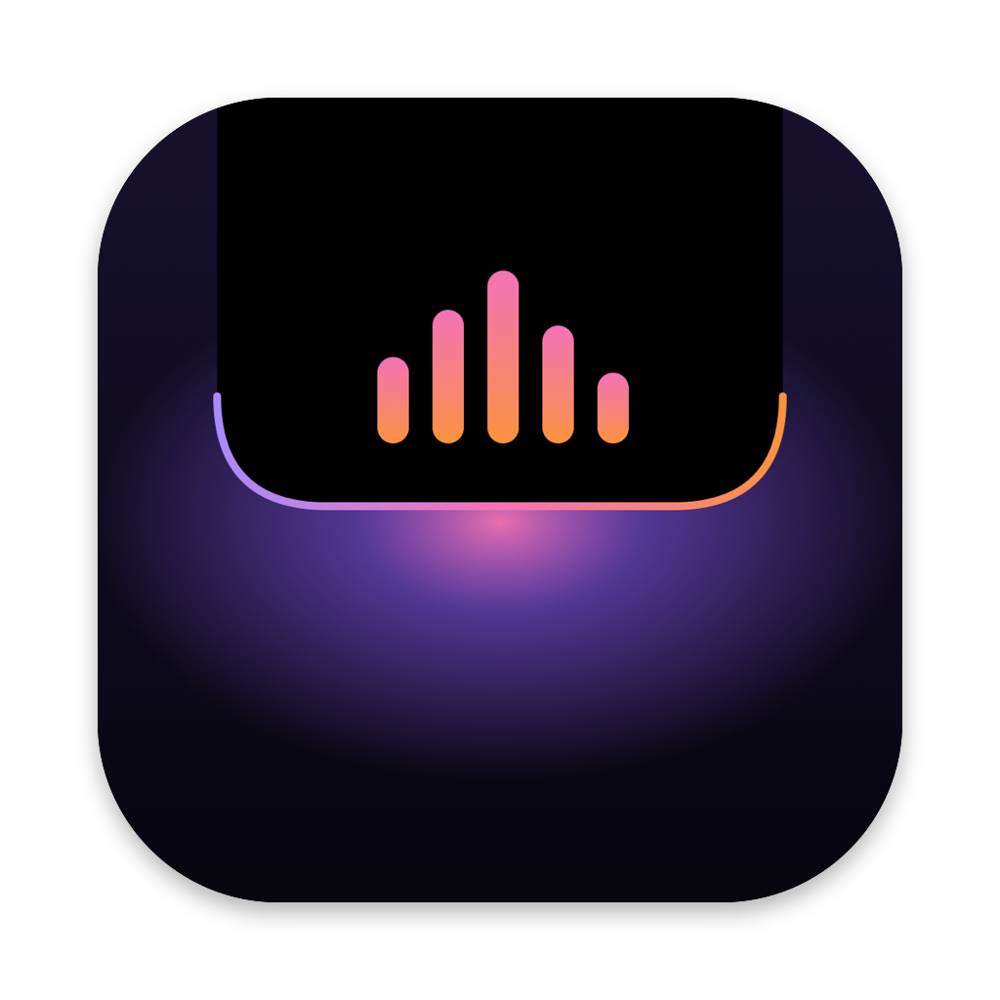
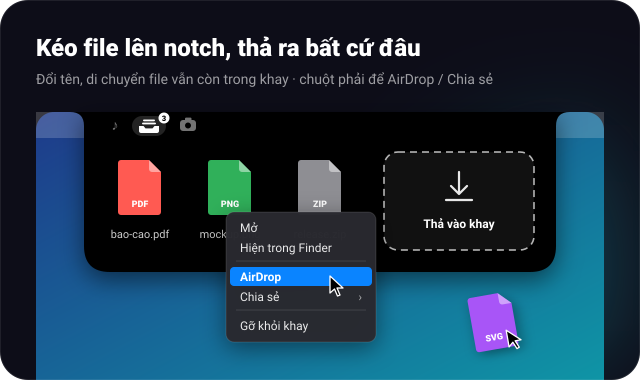

<p align="center">
  
</p>

<h1 align="center">Roost</h1>

<p align="center">
  <b>Notch nhỏ. Việc gì cũng có chỗ.</b><br>
  Nhạc, lịch, khay file, gương camera và yêu cầu của Claude Code, gói gọn ở mép trên màn hình MacBook.
</p>

<p align="center">
  <a href="https://github.com/letoan1/notch-app/releases/latest/download/Roost-1.0.1.dmg"><b>Tải Roost cho Mac (.dmg)</b></a>
  &nbsp;·&nbsp;
  <a href="site/index.html">Trang giới thiệu</a>
  &nbsp;·&nbsp;
  <a href="docs/INSTALL.md">Hướng dẫn cài</a>
  &nbsp;·&nbsp;
  <a href="#câu-hỏi-thường-gặp">Câu hỏi thường gặp</a>
</p>

<p align="center">
  <a href="https://github.com/letoan1/notch-app/releases"></a>
  
  
  
  
  <a href="LICENSE"></a>
</p>

<p align="center">
  
</p>

<p align="center"><sub>English: Roost is a free, open-source notch app for macOS 14+. Music, calendar, a file shelf, a camera mirror, Claude Code approvals and four themed skins, with near-zero CPU while idle. The UI is in Vietnamese and English.</sub></p>

---

## Vì sao là Roost

| | | |
|:---|:---|:---|
| **🎧 Nhạc của mọi app**<br>Spotify, Apple Music, YouTube, Podcasts. Ảnh bìa, tua, sóng nhạc; lời bài hát với Spotify và Apple Music. | **🤖 Duyệt Claude Code ngay trên notch**<br>Cho phép, từ chối hay trả lời câu hỏi mà không phải quay lại terminal. Xem luôn mức dùng 5 giờ, 7 ngày. | **📥 Khay file kéo thả**<br>Cất tạm file, ảnh chụp màn hình tự vào khay, AirDrop bằng chuột phải. |
| **📅 Lịch và cuộc họp**<br>Dải 7 ngày, một nút vào Meet, Zoom hay Teams. | **🔊 Âm thanh từng app**<br>Chọn loa, mic, chỉnh âm lượng tổng và riêng từng app đang phát. | **🪞 Gương camera**<br>Soi mặt trước khi họp, kèm đèn viền khi thiếu sáng. |
| **🎨 Bốn giao diện có câu chuyện**<br>Mặc định, Pixel 8-bit, Cassette, Van Gogh. Mỗi tab hoạt động theo theme. | **🪶 Nhẹ tới mức quên là nó đang chạy**<br>0,01% CPU khi thu gọn, không vòng lặp nền. | **🔒 Không analytics, không theo dõi**<br>Quyền chỉ xin khi bạn dùng tới. Mac có tai thỏ hay không đều dùng được. |

## Bắt đầu trong một phút

1. Tải `Roost-<phiên bản>.dmg` ở trang [Releases](https://github.com/letoan1/notch-app/releases). Một file chạy cho cả Mac chip Apple và Mac Intel, macOS 14 trở lên.
2. Mở file, kéo **Roost** vào **Applications**.
3. Lần mở đầu, macOS báo không xác minh được nhà phát triển vì Roost chưa ký Developer ID. Vào **System Settings › Privacy & Security**, bấm **Open Anyway**. Chỉ làm một lần.

Rê chuột lên notch là xong. Phím tắt mặc định: <kbd>⌥</kbd> <kbd>Space</kbd>. Cách kiểm tra SHA-256 của file tải về nằm ở [docs/INSTALL.md](docs/INSTALL.md).

---

## Bốn giao diện, bốn câu chuyện

<p align="center"></p>

Đổi trong **Cài đặt › Giao diện**, notch đổi ngay. Ba theme Pixel, Cassette và Van Gogh không chỉ đổi màu: mỗi tab có hành vi và hiệu ứng chuyển cảnh riêng.

<details>
<summary><b>👾 Pixel 8-bit</b>: máy game thùng, nghe hết bài là LEVEL UP</summary>
<br>
<p align="center"></p>

Thanh tiến độ là thanh EXP; nghe xong một bài là lên cấp. Lịch là màn chọn level, ngày có họp có quái vật pixel, hôm nay có lá cờ nhấp nháy. Khay là ô đồ đạc: thả file vào hiện "+1 ITEM", gỡ ra thì file vỡ thành pixel; khay trống là rương kho báu mở nắp khi bạn kéo file tới. Gương có chế độ Selfie 8-bit. Yêu cầu của Claude hiện như hộp thoại game nhập vai, chọn bằng con trỏ ▶. Font VT323 đủ dấu tiếng Việt, mọi hình pixel là thiết kế riêng của Roost.
</details>

<details>
<summary><b>📼 Cassette</b>: góc bàn thập niên 80, băng từ, Polaroid và telex</summary>
<br>
<p align="center"></p>

Trình phát là cuộn băng có hai trục quay; kéo ngang thân băng để tua. Lịch bloc xé tờ khi đổi ngày. Trong khay, ảnh là Polaroid, nhạc là băng cassette, file khác là đĩa mềm dán nhãn tay. Gương là máy ảnh lấy liền: bấm Chụp, ảnh trồi ra rồi hiện dần, file gốc lưu vào `~/Pictures/Roost`. Yêu cầu của Claude in trên tờ telex, bấm nút nào thì con dấu đó đóng lên giấy.
</details>

<details>
<summary><b>🌻 Van Gogh</b>: xưởng vẽ sơn dầu, hoạ sĩ tí hon đi trên vệt cọ</summary>
<br>
<p align="center"></p>

Nền notch là tranh sơn dầu kiểu "Đêm đầy sao". Thanh tiến độ là vệt cọ vàng, ảnh bìa được vẽ lại thành tranh. Ngày có họp mọc hoa hướng dương, càng nhiều họp hoa càng to. Khay trống là bức "Giỏ táo"; file thả vào hiện dần như được vẽ lên. Gương có nút Nét cọ vẽ lại hình camera theo thời gian thực và nút Chụp chân dung. Yêu cầu của Claude là lá thư viết tay.
</details>

---

## Tính năng

### Claude Code hỏi, bạn trả lời ngay trên notch

<table>
<tr>
<td width="50%"></td>
<td width="50%"></td>
</tr>
</table>

Khi Claude Code xin chạy lệnh, sửa file hay hỏi một câu, notch tự mở và hiện thẻ: project, phiên, app đang chạy Claude (VS Code, Terminal, iTerm) và đồng hồ đếm ngược. Nhiều phiên cùng hỏi thì xếp hàng kiểu "1/3", trả lời thẻ này không ảnh hưởng thẻ khác. Một nút đưa bạn về đúng cửa sổ của phiên đó. Cài đặt ở mục [Nối với Claude Code](#nối-với-claude-code).

### Nhạc, lịch và mọi thứ liếc là thấy

<table>
<tr>
<td width="50%"></td>
<td width="50%"></td>
</tr>
</table>

- **Nhạc**: bài đang phát của Spotify, Apple Music, YouTube trên trình duyệt, Podcasts. Ảnh bìa, kéo tua, điều khiển, trộn bài và lặp lại khi app hỗ trợ; bấm ảnh bìa để mở app. Khi thu gọn, hai cánh notch hiện ảnh bìa và sóng nhạc, viền có quầng sáng theo màu ảnh bìa.
- **Lời bài hát**: chạy theo nhạc với Spotify và Apple Music, lấy từ [LRCLIB](https://lrclib.net). Khi máy khoá, màn hình khoá có widget nhạc với ảnh bìa và nút điều khiển.
- **Lịch**: dải 7 ngày lấy hôm nay làm giữa, vuốt trackpad để đổi tuần, nút vào thẳng Google Meet, Zoom hay Teams.
- **Nhiều màn hình**: notch hiện trên màn hình có tai thỏ, màn hình chính, màn hình có con trỏ hoặc tất cả. Màn hình rời có notch vẽ thêm hoặc kiểu viên nổi. Toàn màn hình thì notch thu về dạng tối giản.

### Âm thanh

Tab Âm thanh chọn loa và mic, chỉnh âm lượng tổng, mic, và một thanh dọc cho từng app đang phát (cần macOS 14.2 trở lên và quyền Ghi âm thanh hệ thống). Để một app ở đúng 100% thì Roost không chạm vào đường âm thanh của app đó.

### Khay file

<table>
<tr>
<td width="50%"></td>
<td width="50%"></td>
</tr>
</table>

Kéo file lên notch để cất tạm, kéo ra thả vào app khác. <kbd>⌘</kbd>-bấm để chọn nhiều, <kbd>Space</kbd> mở Quick Look. Ảnh chụp màn hình tự vào khay, kể cả khi chụp vào clipboard. Khay giữ liên kết tới file gốc nên đổi tên hay chuyển chỗ vẫn không mất. Chuột phải để AirDrop, chia sẻ, hiện trong Finder. Tự dọn sau 1, 7 hoặc 30 ngày.

### Gương camera và thú cưng

<p align="center"></p>
<p align="center"></p>

Soi webcam trước khi họp, kèm cuộc họp sắp tới. Roost nhắc khi mặt lệch khung, ngồi quá gần hay quá xa, và gợi ý bật **đèn viền** (Dịu, Vừa, Mạnh) khi thiếu sáng. Camera chỉ chạy khi tab đang mở.

Mỗi giao diện có một thú cưng ngồi ở cánh notch: nhảy theo nhạc, nhìn theo con trỏ, đeo tai nghe khi âm thanh ra AirPods, giật mình khi Claude xin quyền. Chạy bằng Core Animation nên gần như không tốn CPU.

### Tuỳ chỉnh theo ý bạn

<p align="center"></p>

- Hai cánh notch khi thu gọn: ảnh bìa, sóng nhạc, cuộc họp kế tiếp, pin, giờ hoặc để trống.
- Thứ tự tab, tab mở mặc định, màu nhấn theo ảnh bìa hoặc cố định.
- Mở bằng bấm hoặc rê chuột. Chế độ "Thông minh" chỉ mở khi con trỏ chậm lại, lướt qua để bấm thanh menu thì không mở.
- Kích thước Gọn, Vừa, Rộng; phím tắt; rung nhẹ trên trackpad Force Touch; Tiếng Việt hoặc English.
- **Bố cục notch**: đặt tối đa 3 nút tròn mỗi bên notch và vài nút trên hàng tab.

### Tiện ích nhỏ

- **Mức dùng Claude**: hạn mức 5 giờ và 7 ngày trên hàng tab, bấm để xem chi tiết. Bạn tự bật; Roost đọc access token Claude Code trong Keychain và chỉ gửi tới `api.anthropic.com`.
- **HUD âm lượng và độ sáng**: bấm phím âm lượng, độ sáng hay đèn bàn phím thì giá trị hiện ở hai cánh notch thay cho HUD của macOS (cần quyền Trợ năng).
- **Giữ máy thức**: giữ Mac và màn hình thức theo giờ, tự tắt khi pin còn 10%, khi gập máy hoặc khi app bạn chọn thoát.
- **Lau phím**: khoá bàn phím để lau. Bấm Esc 5 lần hoặc bấm thẻ trên notch để mở, tự mở sau 3 phút.
- **Thông báo nhanh**: cắm sạc, kết nối tai nghe, bật Caps Lock, Claude đang chờ bạn đều hiện vài giây ở hai cánh notch.

<details>
<summary><b>🧪 Mở khoá bằng khuôn mặt (thử nghiệm, mặc định tắt)</b></summary>
<br>
<p align="center"></p>

Bật ở **Cài đặt › Khuôn mặt**. Khi máy khoá hay thức dậy, Roost quét mặt qua camera; đúng người thì app gõ mật khẩu đăng nhập đã lưu vào màn hình khoá. Không bật thì notch vẫn chạy hiệu ứng Face ID khi bạn mở khoá bằng Touch ID, Apple Watch hay mật khẩu, và không dùng camera.

> [!WARNING]
> Đây là tiện ích, không phải lớp bảo mật. Camera MacBook chỉ thấy ảnh 2D. Bước kiểm tra người thật chặn được ảnh in và ảnh trên điện thoại, nhưng video quay mặt bạn vẫn có thể qua. Không thay được việc nhập mật khẩu sau khi khởi động lại.

Mật khẩu và dữ liệu khuôn mặt mã hoá AES-256, khoá nằm trong login keychain và chỉ lấy ra sau khi bạn xác thực bằng Touch ID hoặc mật khẩu. Sai 5 lần liên tiếp thì ngừng quét. Chỉ nhận camera thật, không nhận Continuity Camera hay camera ảo. Nhật ký 50 lần thử gần nhất xem và xoá được trong Cài đặt.
</details>

---

## Nối với Claude Code

Màn hình chào lần đầu có nút sao chép cấu hình (mở lại ở **Cài đặt › Giới thiệu**). Hoặc thêm vào `~/.claude/settings.json`, hay `.claude/settings.json` của từng project:

```json
{
  "hooks": {
    "PermissionRequest": [{
      "matcher": "*",
      "hooks": [{ "type": "command", "command": "/Applications/Roost.app/Contents/MacOS/roost-hook", "timeout": 110 }]
    }],
    "PostToolUse": [{
      "matcher": "*",
      "hooks": [{ "type": "command", "command": "/Applications/Roost.app/Contents/MacOS/roost-hook", "timeout": 5 }]
    }],
    "PostToolUseFailure": [{
      "matcher": "*",
      "hooks": [{ "type": "command", "command": "/Applications/Roost.app/Contents/MacOS/roost-hook", "timeout": 5 }]
    }],
    "Stop": [{
      "hooks": [{ "type": "command", "command": "/Applications/Roost.app/Contents/MacOS/roost-hook", "timeout": 5 }]
    }],
    "SessionEnd": [{
      "hooks": [{ "type": "command", "command": "/Applications/Roost.app/Contents/MacOS/roost-hook", "timeout": 5 }]
    }]
  }
}
```

Xem thử thẻ mà không cần mở Claude: `scripts/demo-claude.sh` (thêm `--question` cho thẻ câu hỏi). Script chỉ in ra lựa chọn của bạn, không ghi gì vào cài đặt Claude.

<details>
<summary><b>Hook hoạt động thế nào</b></summary>
<br>

- `roost-hook` gửi yêu cầu sang app qua Unix socket `~/Library/Application Support/Roost/claude.sock` (quyền 0600). App tắt, hết giờ, hay Roost bị tắt giữa chừng thì hook trả về mà không quyết định gì, Claude Code hỏi bạn như bình thường. **Claude Code không bao giờ bị treo vì Roost.**
- Hộp thoại trong terminal chạy song song. Bốn event `PostToolUse`, `PostToolUseFailure`, `Stop`, `SessionEnd` dùng chung binary, chạy trong vài mili giây để gỡ thẻ bạn đã trả lời ở terminal. Thiếu chúng thì thẻ chỉ nằm lại tới khi hook hết giờ.
- "Luôn cho phép" chỉ áp đúng quy tắc hẹp nhất Claude gợi ý, ví dụ `Bash(npm test:*)`. Thẻ ghi rõ quy tắc và nơi lưu (chỉ phiên này, hay `.claude/settings.local.json` của project) trước khi bạn bấm. Roost không bao giờ bật chế độ bỏ qua quyền.
- **Cài đặt › Claude Code** liệt kê các quy tắc Roost đã cấp, kèm nút Thu hồi. App sao lưu file rồi chỉ gỡ đúng dòng đó.
</details>

---

## Quyền riêng tư

Roost không có analytics hay theo dõi. App chỉ kết nối Internet cho hai việc bạn chủ động dùng:

- **Lời bài hát**: tải từ `lrclib.net` khi bạn mở lời, lưu đệm trên máy.
- **Mức dùng Claude** (tự bật): gọi `api.anthropic.com` bằng access token Claude Code của bạn. Roost không đụng refresh token, không ghi vào Keychain, không lưu hay in token.

Mỗi quyền chỉ được xin khi bạn dùng tới tính năng cần nó.

| Quyền | Dùng cho | Bắt buộc? |
|---|---|---|
| Lịch | Sự kiện, nút vào họp, đếm ngược ở cánh notch | Chỉ khi dùng lịch |
| Camera | Tab Gương, mở khoá bằng khuôn mặt. Ảnh chỉ lưu khi bạn bấm chụp | Không |
| Tự động hoá (Apple Events) | Đọc bài và điều khiển Spotify, Music khi cách chính không dùng được | Không |
| Ghi âm thanh hệ thống | Sóng nhạc theo âm thanh thật và âm lượng từng app. Không ghi hay lưu âm thanh | Không |
| Trợ năng | HUD âm lượng và độ sáng, chế độ lau phím, gõ mật khẩu khi mở khoá bằng khuôn mặt | Chỉ cho các tính năng đó |
| Keychain | Khoá mã hoá của mở khoá bằng khuôn mặt; đọc token Claude Code khi bật mức dùng | Chỉ cho các tính năng đó |

Roost nhận biết toàn màn hình qua khung cửa sổ, không cần quyền ghi màn hình. Ảnh chụp màn hình được nhận qua Spotlight và clipboard, chỉ khi công cụ chụp của macOS vừa chạy.

## Hiệu năng

<p align="center"></p>

Khi thu gọn, Roost chỉ thức dậy khi có sự kiện chuột, nhạc hay hệ thống. Thanh tiến độ, sóng nhạc, thú cưng và hiệu ứng chạy bằng Core Animation trong render server của macOS.

| Trạng thái (giao diện Mặc định) | CPU | RAM |
|---|---|---|
| Thu gọn, máy rảnh | **0,01%** | 30 MB lúc vừa mở |
| Thu gọn, đang phát nhạc | 0,35% | |
| Mở tab Nhạc, đang phát | 1,6% | |
| Mở tab Khay | 1,7% | |
| Mở tab Gương, camera bật | 9% | 142 MB |
| Sau 20 lần mở và đóng notch | | 42 MB |

<details>
<summary>Số liệu theo từng giao diện và cách đo</summary>
<br>

| Giao diện, lúc không phát nhạc | Thu gọn | Mở tab Nhạc | Mở tab Khay |
|---|---|---|---|
| Pixel 8-bit | 0,04 đến 0,15% | 0,2% | 0% |
| Cassette | 0% | 0 đến 0,7% | 0,01% |
| Van Gogh | 0% | 0,11% | 0% |

Đo ngày 14/11/2026 trên MacBook Air M2, macOS 27, bằng `top`, trung bình 20 giây mỗi mốc. `leaks` báo 0 chỗ rò bộ nhớ. Sau khi tắt camera RAM về khoảng 100 MB, vì macOS giữ model Vision và bộ xử lý camera tới khi app tắt. Chi tiết ở [docs/RELEASE-CHECKLIST.md](docs/RELEASE-CHECKLIST.md).
</details>

---

## Câu hỏi thường gặp

<details>
<summary><b>macOS báo "Apple could not verify Roost is free of malware". App có an toàn không?</b></summary>
<br>
Cảnh báo này hiện với mọi app chưa được Apple notarize, không có nghĩa app có mã độc. Notarize cần gói Apple Developer Program 99 USD mỗi năm, Roost chưa đăng ký. Toàn bộ mã nguồn nằm trong repo này, bạn có thể đọc và tự build. Cách mở app có trong <a href="docs/INSTALL.md">docs/INSTALL.md</a>.
</details>

<details>
<summary><b>Sao Roost không có trên Mac App Store?</b></summary>
<br>
Roost dùng API riêng của Apple để đọc bài đang phát (MediaRemote) và hiện trên màn hình khoá (SkyLight), đồng thời cài hook vào cấu hình Claude Code. App Store cấm API riêng và bắt chạy trong sandbox.
</details>

<details>
<summary><b>Sao không thấy icon trên Dock?</b></summary>
<br>
Roost chạy nền như app thanh menu. Mở Cài đặt bằng biểu tượng bánh răng trên notch.
</details>

<details>
<summary><b>Máy không có tai thỏ dùng được không?</b></summary>
<br>
Được. Roost vẽ một notch giả ở giữa mép trên, hoặc bạn chọn kiểu viên nổi trong Cài đặt.
</details>

<details>
<summary><b>Tắt Roost thì Claude Code có bị ảnh hưởng không?</b></summary>
<br>
Không. Hook trả về ngay mà không quyết định gì, Claude Code hỏi bạn trong terminal như bình thường.
</details>

<details>
<summary><b>Tôi đang dùng bản cũ tên Notch?</b></summary>
<br>
Lần đầu chạy, Roost tự chép cài đặt cũ và đổi thư mục <code>~/Library/Application Support/Notch/</code> thành <code>Roost/</code>. Vì bundle id đã đổi, macOS sẽ hỏi lại các quyền một lần.
</details>

## Lộ trình

- [ ] Ký Developer ID và notarize, mở app không còn cảnh báo
- [ ] Tự cập nhật phiên bản mới
- [ ] Theme Cung đình: sơn mài, hồi văn, lịch âm
- [ ] Lịch âm như tuỳ chọn chung cho mọi giao diện

---

## Dành cho nhà phát triển

Cần macOS 14+ và Command Line Tools (`xcode-select --install`). **Không cần Xcode.**

```bash
git clone https://github.com/letoan1/notch-app.git
cd notch-app
scripts/make-signing-cert.sh   # một lần: chứng chỉ ký tự ký trong login keychain
./build.sh install             # build, ký, cài vào /Applications/Roost.app rồi mở
```

Chứng chỉ cố định giúp macOS nhớ các quyền đã cấp qua những lần build. Không có chứng chỉ thì `build.sh` ký ad-hoc và macOS hỏi lại quyền sau mỗi lần build. Khi macOS hỏi quyền dùng khoá trong Keychain, bấm **Always Allow**.

| Lệnh | Việc |
|---|---|
| `./build.sh run` | Chạy bản trong `build/` mà không cài |
| `scripts/make-dmg.sh` | Đóng gói `dist/Roost-<phiên bản>.dmg` universal |
| `scripts/set-icon.sh <ảnh>` | Đổi icon app; `--default` để về icon mặc định |
| `scripts/demo-claude.sh` | Gửi yêu cầu Claude Code giả để xem thẻ trên notch |

SwiftUI + AppKit, build bằng Swift Package Manager. SDK macOS 27 biến `@State` và `@Namespace` thành macro chỉ có trong Xcode, nên code dùng `State(initialValue:)` và `Namespace()` tường minh. Quy ước code nằm ở [CLAUDE.md](CLAUDE.md). Trang giới thiệu là một file tĩnh ở [site/](site/), mở thẳng bằng trình duyệt hoặc đưa lên GitHub Pages.

## Ghi công và giấy phép

- **mediaremote-adapter** v0.7.7 của [ungive](https://github.com/ungive/mediaremote-adapter), BSD 3-Clause (`Vendor/MediaRemoteAdapter`).
- **FaceUnlockKit** chuyển từ [Glance](https://github.com/jonnyoo/glance) của Jonathan Zhou, MIT. Cửa sổ màn hình khoá dựa trên [SkyLightWindow](https://github.com/Lakr233/SkyLightWindow) của Lakr Aream, MIT. Model ArcFace `w600k_mbf` của [InsightFace](https://github.com/deepinsight/insightface) chỉ dùng cho nghiên cứu phi thương mại. Chi tiết ở `Packages/FaceUnlockKit/NOTICE.md` và `LICENSES/`.
- **Font VT323** từ [Google Fonts](https://fonts.google.com/specimen/VT323), SIL Open Font License 1.1 (`Resources/OFL-VT323.txt`).
- **Ảnh nền và nhân vật hoạ sĩ** của giao diện Van Gogh được tạo bằng AI, lấy cảm hứng từ tranh Vincent van Gogh (phạm vi công cộng).

Mã nguồn Roost phát hành theo [giấy phép MIT](LICENSE). **Ngoại lệ:** model ArcFace trong `Packages/FaceUnlockKit` không thuộc MIT và chỉ dùng cho nghiên cứu phi thương mại. Muốn dùng Roost cho việc thương mại, hãy bỏ tính năng mở khoá bằng khuôn mặt hoặc thay bằng model có giấy phép phù hợp.

<p align="center"><sub>Làm ở Việt Nam, cho những ai mở MacBook cả ngày.</sub></p>
